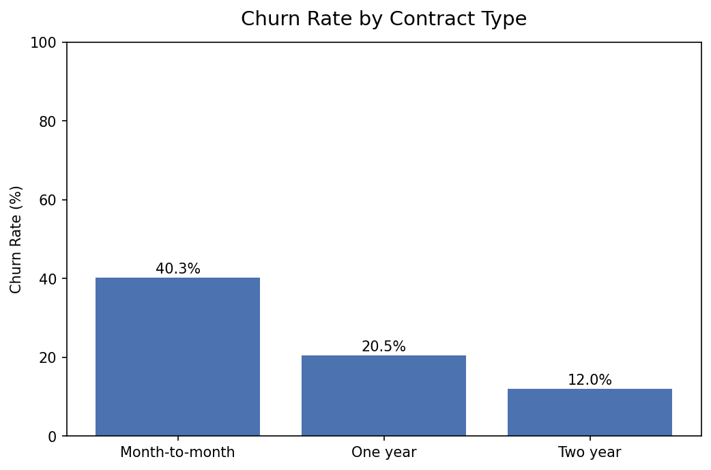
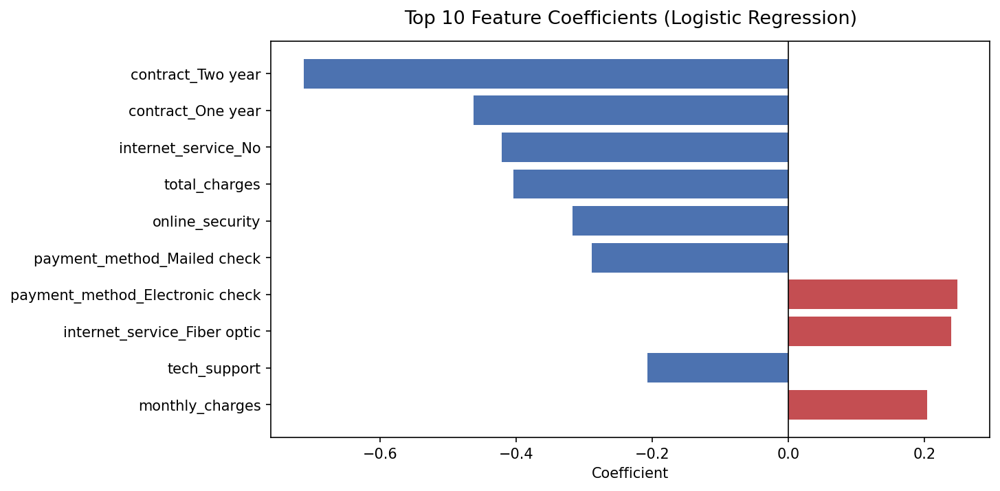

# Customer Churn Prediction — Telecom


In telecom, keeping a customer is much cheaper than winning a new one. A retention team can't call everyone, though, so the useful question isn't "will this customer leave?" but **"who should we call first?"**

This project answers it with a clean Python pipeline: raw customer data → feature encoding → logistic regression → evaluation → a ranked list of customers by churn risk, ready to load into Power BI.

> **Data note:** 500 synthetic telecom customers generated by `data/generate_data.py` (contract, tenure, internet service, payment method, charges...). 29.4% of them churned.

## Results

| Metric | Value |
|---|---|
| ROC-AUC (test set) | **0.71** |
| ROC-AUC (5-fold cross-validation) | **0.72 ± 0.03** |
| Churners caught (recall) | **59%** |
| Accuracy | 0.68 |

Accuracy is not the target here: a model that predicts "stays" for everyone would score ~70% and be useless. The model is tuned (`class_weight="balanced"`) to **catch churners**.

### What it means for a retention team

| Risk band | Customers | Actual churn rate |
|---|---|---|
| **High** | 152 (30%) | **52.6%** |
| Medium | 139 | 28.8% |
| Low | 209 | 12.9% |

Calling only the 152 high-risk customers reaches **54% of all churners**, with a hit rate 1.8× the average. The full ranked list is written to `reports/customers_scored.csv`.

### What drives churn




- **Contract type is the strongest signal**: 40% of month-to-month customers leave, vs 12% on two-year contracts.
- Fiber optic, electronic check payment and higher monthly charges push churn up.
- Online security, tech support and longer relationships (total charges) pull it down.

## A bug worth telling

The first version reported a respectable accuracy, but the ROC-AUC was 0.54 and it caught only **3% of churners**. The cause: `pd.get_dummies` returns boolean columns, and `select_dtypes("number")` silently dropped them, so **contract type, internet service and payment method never reached the model**.

The fix is one argument (`dtype=int`), and a regression test (`TC-MOD-009`) now fails if a categorical feature ever disappears again. The same test mindset that I apply to data pipelines applies to models: check what actually reaches the model, not just the final score.

## Structure

```
src/
  preprocessing.py    # load, encode (one-hot), build feature matrix, churn rate by segment
  model.py            # train/evaluate, cross-validation, feature importance, customer scoring
  visualizations.py   # five charts saved to reports/
  run_model.py        # entry point
tests/
  test_preprocessing.py   # 10 tests TC-CHR-001→010
  test_model.py           # 11 tests TC-MOD-001→011 (recall, AUC, CV stability, regression test)
data/
  customers.csv       # 500 synthetic customers
  generate_data.py    # generator
reports/              # charts + customers_scored.csv (risk list for Power BI)
```

## Running it

```bash
pip install -r requirements.txt
cd src && python run_model.py
cd .. && pytest tests/ -v
```

## Next steps

- Try a gradient boosted model (XGBoost / LightGBM) and compare it with the cross-validated baseline.
- Explain individual predictions with SHAP, so the retention team knows *why* a customer is at risk.
- Build a Power BI page on `customers_scored.csv`: risk bands, filters by contract and tenure, a call list.

## Stack

Python, pandas, scikit-learn, Matplotlib, pytest, GitHub Actions
